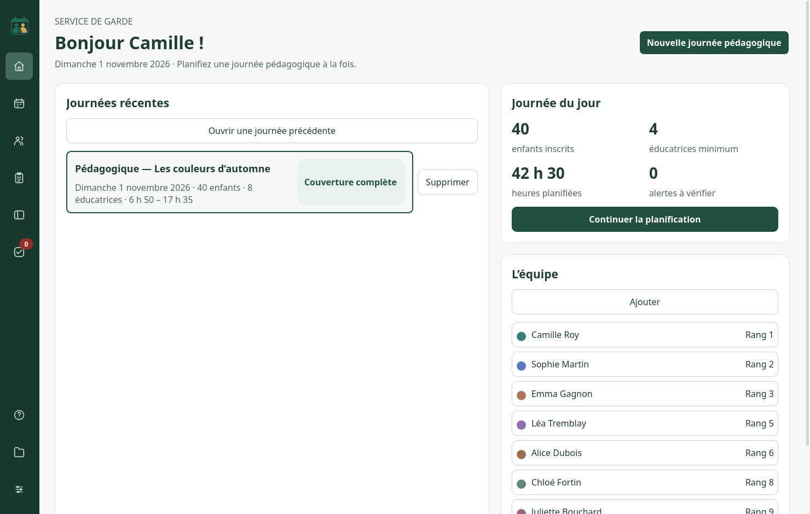
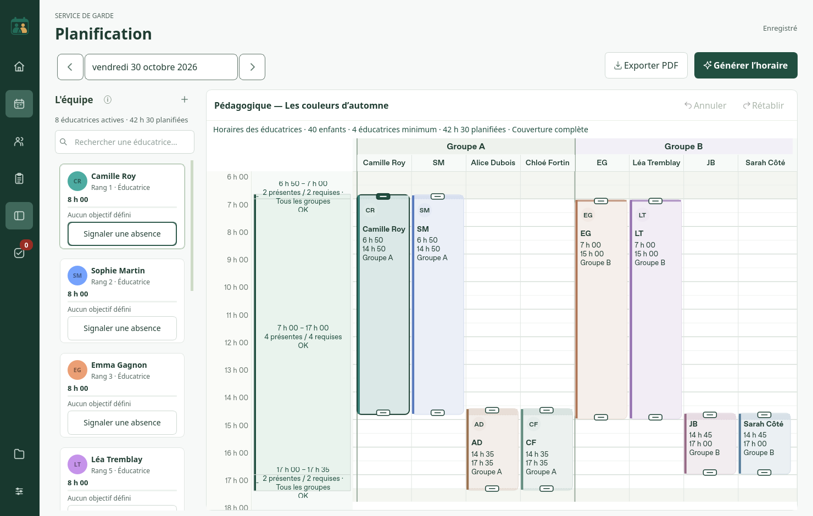
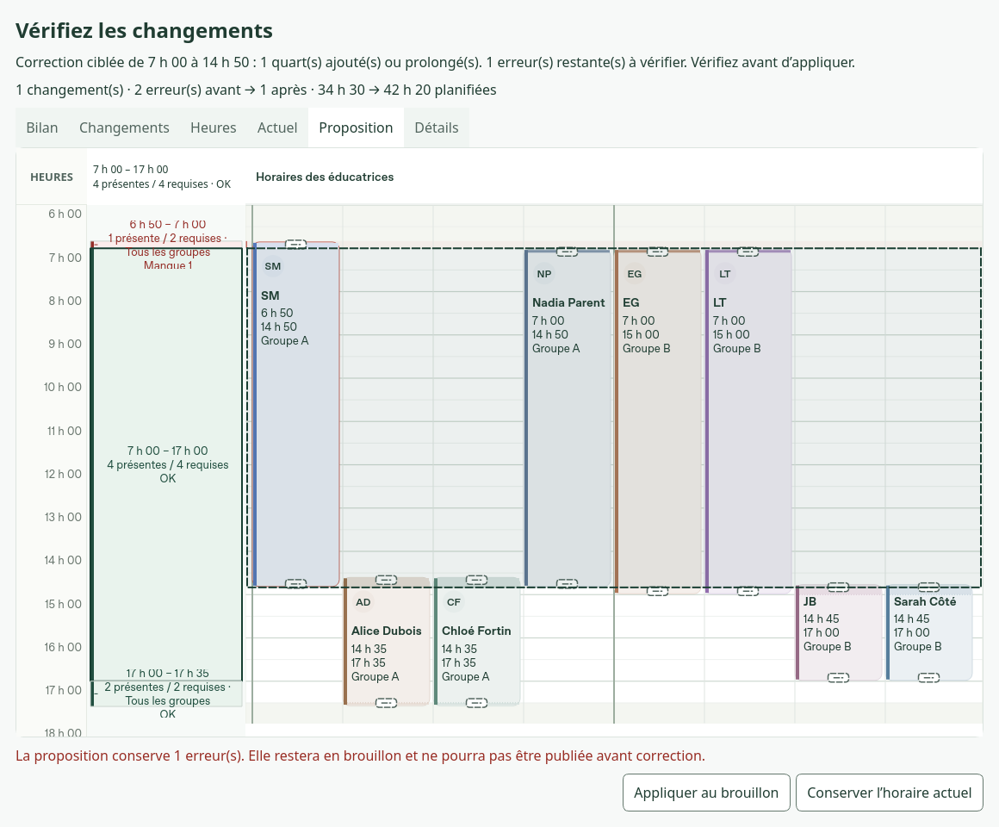
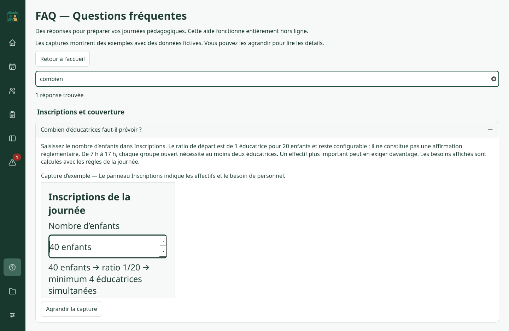

<a id="haut"></a>

<h1 align="center">Planificateur — Service de garde</h1>

<p align="center">
  
</p>

<p align="center">
  <strong>Une journée pédagogique. Une équipe. Un horaire clair.</strong><br>
  Préparez, vérifiez et imprimez vos horaires dans une application de bureau en français.
</p>

<p align="center">
  <strong>Windows et Mac</strong> &nbsp;·&nbsp; Sans installation &nbsp;·&nbsp; Entièrement hors ligne<br>
  Sans compte, sans abonnement. Vos données restent sur votre ordinateur.
</p>

<p align="center">
  <a href="#telecharger"><strong>Télécharger la version 0.5.2</strong></a>
  &nbsp;·&nbsp;
  <a href="docs/GUIDE.md">Guide d’utilisation</a>
  &nbsp;·&nbsp;
  <a href="CHANGELOG.md">Notes de version</a>
</p>

<p align="center">
  <a href="#apercu">Découvrir</a> &nbsp; / &nbsp;
  <a href="#demarrer">Premiers pas</a> &nbsp; / &nbsp;
  <a href="#regles">Règles de planification</a> &nbsp; / &nbsp;
  <a href="#aide">Aide et mises à jour</a> &nbsp; / &nbsp;
  <a href="#projet">L’histoire du projet</a> &nbsp; / &nbsp;
  <a href="#documentation">Documentation</a>
</p>



<p align="center"><sub>Captures réelles de l’application, avec des données fictives.</sub></p>

---

<a id="telecharger"></a>

## Télécharger

**Version stable : 0.5.2** — un dossier à décompresser, un programme à ouvrir.

| Votre ordinateur | Téléchargement |
| :--- | :--- |
| **Windows 10 ou 11 · 64 bits** | [**Télécharger le ZIP Windows**](https://github.com/GraphicShack/Planificateur-Service-de-garde/releases/download/v0.5.2/Planificateur-SDG-0.5.2-Windows-x64-Portable.zip) |
| **Mac Apple Silicon · macOS 15 ou plus récent** | [**Télécharger le ZIP Mac**](https://github.com/GraphicShack/Planificateur-Service-de-garde/releases/download/v0.5.2/Planificateur-SDG-0.5.2-macOS-arm64-Portable.zip) |

Aucun installateur ni Python à ajouter sur le poste utilisateur. Extrayez **le dossier complet** dans un emplacement où vous pouvez enregistrer des fichiers, par exemple Documents.

[Notes de la 0.5.2 et rapports de contrôle](https://github.com/GraphicShack/Planificateur-Service-de-garde/releases/tag/v0.5.2) · [Toutes les versions](https://github.com/GraphicShack/Planificateur-Service-de-garde/releases)

<a id="apercu"></a>

## Une journée, du premier quart au PDF

| Pour… | Le planificateur vous permet de… |
| :--- | :--- |
| **Préparer la journée** | Retrouver vos journées récentes, choisir une date, nommer la journée et saisir les inscriptions. |
| **Organiser l’équipe** | Gérer les profils, les disponibilités, les couleurs et les rangs de 1 à 11, avec des rangs libres possibles. |
| **Ajuster les horaires** | Glisser les éducatrices dans la grille, déplacer les quarts et les redimensionner à la minute. |
| **Vérifier la couverture** | Repérer les manques, lire les alertes et rejoindre la plage concernée. Le ratio peut être masqué. |
| **Générer une proposition** | Planifier tous les groupes, préserver les quarts verrouillés et examiner le bilan avant d’appliquer. |
| **Conserver et imprimer** | Enregistrer, dupliquer, consulter les versions et exporter un PDF général prêt à imprimer. |

Les panneaux Équipe, Inscriptions et Vérification partagent le même espace à gauche. L’annulation conserve 50 actions. Quatre thèmes, un accent personnalisé et des animations désactivables adaptent l’affichage à vos préférences.

**Nouveau dans la 0.5.2 :** une FAQ avec recherche et **14 captures agrandissables**, des icônes accessibles depuis l’accueil et des retours au survol plus visibles.

<details>
<summary><strong>Voir la grille de planification</strong></summary>

Les groupes et leurs éducatrices restent séparés. Les quarts utilisent les couleurs de l’équipe et conservent les heures exactes.



</details>

<details>
<summary><strong>Voir une proposition avant de l’appliquer</strong></summary>

La génération ouvre d’abord la grille proposée. Le bilan compare les heures, la couverture, les interruptions et les préférences. Vous gardez le choix de l’appliquer ou de conserver l’horaire actuel.



[Voir le bilan détaillé](docs/bilan-0.5.0.png)

</details>

<details>
<summary><strong>Voir la FAQ illustrée</strong></summary>

La FAQ fonctionne sans Internet. Les questions sont recherchables et chaque capture peut être agrandie pour lire les détails.



</details>

**Un seul PDF général**, au format lettre paysage : jusqu’à huit éducateurs par page, couleurs par groupe, horaires coupés sur une même ligne et interruptions laissées vides. Le titre, la date, la légende et l’échelle sont repris sur chaque page ; le ratio et les alertes restent dans l’application.

[**Consulter un exemple de PDF →**](docs/exemple-horaire-pedagogique.pdf)

<a id="demarrer"></a>

## Vos premiers pas

1. **Ouvrez le logiciel.** Après extraction du ZIP, lancez `Planificateur-SDG.exe` sur Windows ou `Planificateur-SDG.app` sur Mac.
2. **Ajoutez votre équipe.** Depuis l’accueil, saisissez les profils, les disponibilités et les rangs d’ancienneté.
3. **Créez une journée pédagogique.** Indiquez le nombre d’enfants dans Inscriptions, puis ajustez la date et le nom au besoin.
4. **Préparez l’horaire.** Glissez les éducatrices dans la grille ou générez une proposition. Vérifiez la couverture avant d’exporter le PDF.

> **À conserver :** le dossier complet du logiciel, y compris le sous-dossier `donnees`. Fermez le programme avant de déplacer le dossier et gardez une copie de sécurité séparée.

[Ouvrir le guide pas à pas →](docs/GUIDE.md)

<a id="regles"></a>

## Des règles de planification explicites

| Repère | Fonctionnement de départ |
| :--- | :--- |
| **Présence du personnel** | De **6 h 50 à 17 h 35**. |
| **Accueil des enfants** | De **7 h à 17 h 30**. |
| **Ouverture et fin de journée** | De 6 h 50 à 7 h et de 17 h à 17 h 35 : **deux personnes au total, tous groupes confondus**. |
| **Couverture des groupes** | De 7 h à 17 h : **au moins deux éducateurs par groupe ouvert**. |
| **Ratio initial** | Un éducateur pour vingt enfants ; configurable et susceptible d’exiger plus de personnel. |
| **Relève et pauses** | Quinze minutes communes pour la relève. Une pause retire la personne de la couverture, même si elle est payée. |
| **Maximum quotidien** | **8 h rémunérées** par personne, buffers payés compris et pauses non payées déduites. Une limite individuelle plus basse reste prioritaire. |
| **Ancienneté** | Priorité au rang 1, puis aux suivants, après les contraintes obligatoires et les objectifs de participation et de continuité. |

Les durées sont calculées en **minutes entières**. Présence, rémunération et couverture sont distinguées ; un buffer payé ne couvre pas automatiquement les enfants. Le ratio décrit le fonctionnement demandé et n’est pas présenté comme une disposition réglementaire.

La génération cherche à donner des heures au plus grand nombre de personnes, à éviter les trous inutiles, puis à privilégier les quarts continus, davantage d’heures et une fin plus tôt selon le rang. Chaque proposition est vérifiée avant acceptation. Les anciennes journées publiées ou archivées conservent leurs règles.

<a id="aide"></a>

## Aide et mises à jour

Dans l’application, cliquez sur **?** ou appuyez sur **F1** pour ouvrir la FAQ illustrée.

<details>
<summary><strong>Comment mettre le logiciel à jour ?</strong></summary>

**Depuis la version 0.5.0 :** ouvrez **Dossier → Mettre à jour depuis un ZIP**. Choisissez un ZIP officiel plus récent pour votre système et votre architecture. L’assistant prépare un autre dossier avec une copie des données et conserve l’ancien.

Fermez l’ancienne version avant de lancer la nouvelle. Le retour proposé par l’assistant reprend les données d’avant mise à jour et conserve le travail plus récent séparément.

**Depuis la version 0.4.0 ou avant :** fermez le logiciel, sauvegardez votre dossier `donnees`, puis transférez-le dans la nouvelle version extraite. Ne le remplacez pas par un dossier vide.

[Procédure complète et retour à la version précédente](docs/GUIDE.md#assistant-de-mise-à-jour)

</details>

<details>
<summary><strong>Où sont enregistrés les horaires ?</strong></summary>

Les données restent dans le sous-dossier `donnees`, à côté du programme, dans une base SQLite locale. Le menu **Dossier** regroupe l’ouverture, l’enregistrement, la duplication, l’historique et les sauvegardes.

L’application ne transmet pas les horaires à un serveur. Les renseignements sur les élèves se limitent aux effectifs ; aucun nom d’élève n’est nécessaire. La sauvegarde automatique, l’annulation et l’historique accompagnent le travail. Les erreurs bloquantes empêchent la publication d’un horaire ; un brouillon reste enregistrable.

</details>

<details>
<summary><strong>Que faire si macOS bloque l’ouverture ?</strong></summary>

La distribution Mac ne possède pas de notarisation Apple. L’autorisation d’ouverture de macOS est distincte du fonctionnement du logiciel.

Si le programme demande le dossier portable d’origine, sélectionnez le dossier extrait contenant `Planificateur-SDG.app` et `portable.mode`. Cela permet de retrouver un emplacement accessible en écriture lorsque macOS lance une copie temporaire avec AppTranslocation.

[Consulter le guide de distribution Mac](docs/DISTRIBUTION_MACOS.md)

</details>

<a id="projet"></a>

## Une idée née d’un besoin familial

J’ai commencé ce projet pour aider ma mère à répondre à un besoin informatique concret : préparer les horaires d’un service de garde. Elle avait besoin d’un outil simple pour répartir son équipe, ajuster les heures et produire un document facile à imprimer.

Derrière une grille d’horaire se cachent beaucoup de détails : les inscriptions changent, les éducatrices doivent se relayer, les pauses doivent être couvertes et personne ne peut laisser un groupe sans surveillance. Le planificateur s’est construit autour de ces besoins, avec une priorité constante : rendre la planification plus claire et plus facile à utiliser.

Aujourd’hui, il se concentre sur **une journée pédagogique à la fois**, de sa préparation jusqu’à l’impression.

<details>
<summary><strong>Les difficultés rencontrées pendant le développement</strong></summary>

- **Respecter chaque minute.** Conserver les heures exactes tout en distinguant les buffers, les pauses, le temps payé et la couverture réelle des enfants.
- **Simplifier l’interface.** Passer d’une logique hebdomadaire à des journées indépendantes, rendre les textes et les contrôles lisibles, et adapter les formulaires aux différences entre Windows et Mac.
- **Livrer sans installation.** Inclure Python, Qt et les dépendances dans les distributions portables, puis gérer sur Mac les lancements temporaires en lecture seule dus à AppTranslocation.
- **Préserver les horaires existants.** Faire évoluer la base avec une copie de sécurité, sans perdre les versions et les historiques des anciennes journées.
- **Soigner la remise des fichiers.** Proposer des téléchargements publics sans compte GitHub et un PDF fidèle au modèle fourni, y compris pour les horaires coupés et les pages de huit noms.

</details>

<a id="documentation"></a>

## Pour aller plus loin

| Vous cherchez… | Ouvrez… |
| :--- | :--- |
| Une aide pour utiliser le logiciel | [Guide d’utilisation](docs/GUIDE.md) |
| Les changements de chaque version | [Notes de version](CHANGELOG.md) |
| Les règles et les fonctionnalités couvertes | [Exigences et contrôles](docs/EXIGENCES.md) |
| Les résultats et les limites des tests | [État des vérifications](docs/ETAT_VERIFICATION.md) |
| L’organisation du code et des données | [Architecture](docs/ARCHITECTURE.md) |
| La création des exécutables | [Distribution Windows](docs/DISTRIBUTION_WINDOWS.md) · [Distribution Mac](docs/DISTRIBUTION_MACOS.md) |

**Version 0.5.2 vérifiée :** 352 tests et 6 sous-cas réussis sur chaque plateforme. Les constructions natives vérifient le programme compilé, le ZIP extrait, les captures de la FAQ et la mise à jour portable. Les essais physiques sur le poste de l’école restent à réaliser.

<details>
<summary><strong>Développement et lancement depuis les sources</strong></summary>

Le projet utilise **Python 3, PySide6, SQLite, OR-Tools CP-SAT et ReportLab**. Les paquets autonomes sont construits nativement avec PyInstaller ; les distributions utilisent Python 3.12 64 bits.

Après création et activation d’un environnement virtuel :

```sh
python -m pip install -e '.[dev]'
python -m gardeplan
python -m pytest -q
```

`python -m gardeplan --example` ouvre une base distincte avec des données fictives. Les dépendances sont téléchargées pendant la préparation du poste de développement ; le logiciel livré fonctionne ensuite hors ligne.

La génération recherche parmi des quarts candidats. Une absence de solution dans ces candidats ne prouve pas l’impossibilité de tout horaire théorique ; chaque proposition est vérifiée avant acceptation.

</details>

---

<p align="center">
  <a href="#haut">Retour en haut ↑</a>
</p>
