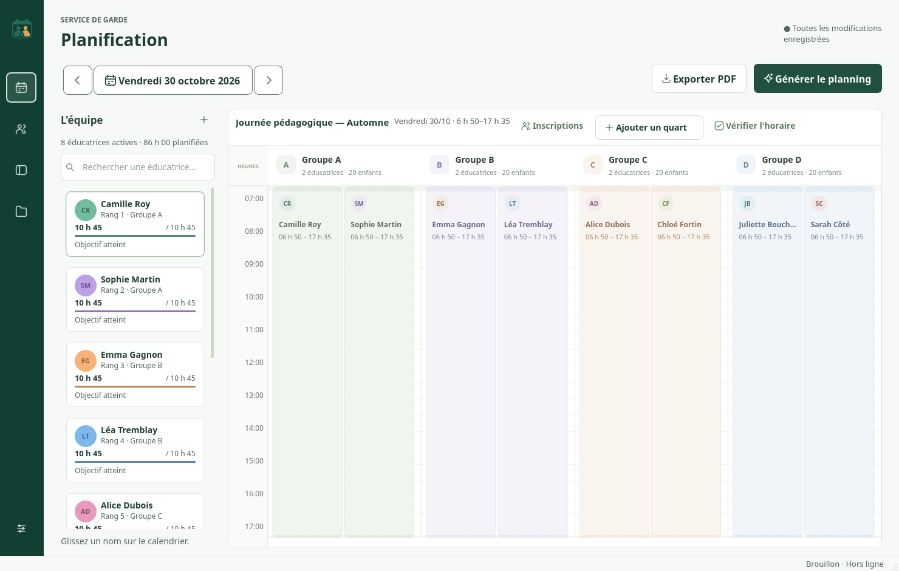

<p align="center">
  
</p>

<h1 align="center">Planificateur — Service de garde</h1>

<p align="center"><strong>Version 0.3.5 · Portable, sans installation</strong></p>

<p align="center">
  <strong>Des horaires clairs pour chaque journée pédagogique.</strong><br>
  Une application de bureau en français, pour Windows et macOS, entièrement utilisable hors ligne.
</p>

<p align="center">
  <a href="https://github.com/GraphicShack/Planificateur-Service-de-garde/releases/download/v0.3.5/Planificateur-SDG-0.3.5-Windows-x64-Portable.zip">Télécharger pour Windows</a>
  &nbsp;·&nbsp;
  <a href="https://github.com/GraphicShack/Planificateur-Service-de-garde/releases/download/v0.3.5/Planificateur-SDG-0.3.5-macOS-arm64-Portable.zip">Télécharger pour Mac</a>
  &nbsp;·&nbsp;
  <a href="docs/GUIDE.md">Guide d’utilisation</a>
</p>



La **version 0.3.5** s’ouvre sur un accueil réunissant les journées récentes, le résumé d’aujourd’hui et l’équipe. La création d’une journée mène directement aux inscriptions. La grille reste organisée par groupes et sous-colonnes d’éducatrices. Les icônes Équipe, Inscriptions et Vérification partagent le panneau gauche ; le ratio est masquable et les alertes sont comptées dans un badge. Annuler et Rétablir sont alignés avec le nom de la journée. Les dîners restent calculés, sans être affichés dans les blocs.

De **6 h 50 à 7 h** et de **17 h à 17 h 35**, le service exige **deux personnes au total, tous groupes confondus**. De **7 h à 17 h**, chaque groupe ouvert exige au moins deux éducateurs. Les pauses doivent être remplacées et les relèves conserver quinze minutes communes. Le ratio configuré (initialement 1/20) peut en exiger davantage. La génération attribue des heures au plus grand nombre de personnes possible, puis privilégie le rang 1 et les suivants : quarts continus, davantage d’heures et fin plus tôt, en limitant les heures inutiles. Le plafond quotidien est de **8 h rémunérées**, buffers compris et pauses non rémunérées déduites. Les anciennes versions publiées et archivées conservent leurs règles. [Détails de la livraison](docs/LIVRAISON_0_3_5.md) · [Notes de version](CHANGELOG.md).

L’interface propose des transitions discrètes et quatre thèmes de couleur : Forêt, Bleu, Prune et Ardoise. Dans **Réglages → Affichage**, choisissez aussi un accent personnalisé, ajusté automatiquement pour préserver le contraste. Les préférences restent locales et suivent le dossier `donnees`. Les animations peuvent être désactivées. [Voir les options d’apparence](docs/themes-interface.png).

Pendant la génération, un indicateur animé et le temps écoulé confirment que la recherche est en cours. Le chargement suit le thème choisi et respecte la désactivation des animations. [Voir le chargement](docs/chargement-horaire.png).

[Voir la couverture et les alertes](docs/couverture-journee.png)

## L’histoire du projet

J’ai commencé ce projet pour aider ma mère à répondre à un besoin informatique concret : préparer les horaires d’un service de garde. Elle avait besoin d’un outil simple pour répartir son équipe, ajuster les heures et produire un document facile à imprimer.

Derrière une grille d’horaire se cachent beaucoup de détails : les inscriptions changent, les éducatrices doivent se relayer, les pauses doivent être couvertes et personne ne peut laisser un groupe sans surveillance. Le logiciel s’est construit autour de ces besoins, avec une priorité constante : rendre la planification plus claire et plus facile à utiliser.

Aujourd’hui, le planificateur se concentre sur une journée pédagogique à la fois, de sa préparation jusqu’à l’impression de l’horaire.

## L’essentiel, dans un seul espace

- **Choisir une journée** dans un champ de date lisible, utilisable au clavier, avec des flèches précédent/suivant.
- **Organiser l’équipe** : une couleur attribuée à chaque nouvelle éducatrice, des heures journalières et un rang de 1 à 11. Les rangs intermédiaires peuvent rester libres.
- **Saisir les inscriptions** et lire immédiatement le besoin total, avec deux éducateurs minimum par groupe.
- **Ajuster les quarts à la minute** par glisser-déposer, redimensionnement ou saisie exacte, avec pauses et temps de préparation.
- **Vérifier la couverture** et demander une proposition automatique respectant les contraintes et les quarts verrouillés.
- **Enregistrer et retrouver les horaires** depuis l’icône Dossier de la barre latérale : ouverture, duplication, historique et sauvegardes locales.
- **Imprimer un seul PDF général**, au format lettre paysage, avec huit éducateurs maximum par page. Les interruptions restent vides.

L’interface se consacre aux horaires. Chaque date conserve ses propres inscriptions, affectations, heures et versions. Le dossier de la barre latérale regroupe les fichiers et les sauvegardes ; les profils se remplissent dans une seule fenêtre claire, sans onglets.

[Voir le formulaire d’ajout d’un profil](docs/ajouter-educateur.png)

## Une journée, des règles explicites

| Repère | Configuration de départ |
| --- | --- |
| Présence du personnel | **6 h 50 à 17 h 35** |
| Accueil des enfants | **7 h à 17 h 30** |
| Préparation et fermeture | Deux éducatrices pour ouvrir et deux pour fermer |
| Relève | Quinze minutes de présence commune |
| Couverture | Deux par groupe de 7 h à 17 h ; deux au total avant 7 h et après 17 h |
| Ratio de départ | Un éducateur pour vingt enfants, configurable |

Les heures sont calculées en minutes entières. La présence, la rémunération et la couverture des enfants sont distinguées : une pause ou un temps de préparation ne constitue pas automatiquement de la surveillance. Le ratio configuré décrit le fonctionnement demandé ; il n’est pas présenté comme une disposition réglementaire.

## Prise en main

1. Téléchargez le ZIP correspondant à votre ordinateur depuis les [versions publiées](https://github.com/GraphicShack/Planificateur-Service-de-garde/releases/latest).
2. Extrayez **tout le dossier** dans un emplacement où vous pouvez enregistrer des fichiers, par exemple Documents.
3. Ouvrez **Planificateur-SDG.exe** sous Windows ou **Planificateur-SDG.app** sous macOS.

Aucune installation de Python, aucun compte et aucun abonnement ne sont nécessaires sur le poste utilisateur. La version Mac proposée cible **Apple Silicon et macOS 15 ou plus récent**.

Vos données restent dans le sous-dossier **donnees**, à côté du programme. Gardez le dossier complet et fermez le logiciel avant de le déplacer. Pour une mise à jour, faites une sauvegarde et conservez votre dossier **donnees** dans la nouvelle version extraite.

## Un horaire prêt à imprimer

Le PDF reprend le modèle de journée pédagogique fourni : titre à gauche, date à droite, noms des éducateurs puis grille de **6 h 50 à 17 h 35**, avec repères de trente minutes et blocs positionnés à la minute. Les horaires coupés apparaissent sur une même ligne ; l’en-tête, la légende et l’échelle sont repris sur chaque page.

[Consulter un exemple de PDF](docs/exemple-horaire-pedagogique.pdf)

## Les difficultés rencontrées

**Respecter les heures réelles.** Les besoins dépassaient une simple grille par heure : il fallait conserver chaque minute et distinguer les buffers, les pauses, le temps payé et la couverture effective du service.

**Trouver une interface suffisamment simple.** Le projet a évolué vers une planification quotidienne, un calendrier plus lisible et un menu Dossier centralisé. La taille des textes, les contrastes et les zones cliquables font partie des critères de vérification. Les différences de dimensions entre Windows et Mac ont aussi nécessité des formulaires qui adaptent leurs colonnes à la place disponible.

**Livrer sans installation.** Python, Qt et les autres dépendances sont inclus dans les distributions portables. Sur Mac, une difficulté particulière venait d’AppTranslocation, qui peut lancer une copie temporaire en lecture seule. Le démarrage retrouve le dossier d’origine ou permet de le choisir. L’autorisation d’ouverture de macOS reste distincte : la distribution ne possède pas de notarisation Apple.

**Préserver les horaires existants.** Le passage d’un fonctionnement hebdomadaire à des journées indépendantes a nécessité une migration avec copie de sécurité, tout en conservant les anciennes photographies et leurs historiques.

**Rendre les fichiers faciles à récupérer et à imprimer.** Les téléchargements destinés aux utilisateurs sont publiés dans les Releases, accessibles sans compte GitHub. Le rendu PDF a été adapté au modèle fourni, aux coupures d’horaire et à la pagination de huit noms par page.

## Données et fiabilité

Les données sont enregistrées localement dans SQLite. L’application n’utilise aucun serveur distant et ne transmet pas les horaires. Les renseignements sur les élèves se limitent aux effectifs ; aucun nom d’élève n’est nécessaire.

La sauvegarde automatique, l’annulation, les copies de sécurité et l’historique accompagnent le travail quotidien. Les erreurs de couverture empêchent la publication d’un horaire ; un brouillon reste enregistrable pour poursuivre les corrections.

Les constructions Windows et Mac exécutent les tests puis vérifient le programme compilé, y compris après extraction du ZIP : calendrier, choix de date, SQLite, génération et PDF. Les résultats et les limites des contrôles sont détaillés dans l’[état des vérifications](docs/ETAT_VERIFICATION.md).

## Documentation

| Besoin | Document |
| --- | --- |
| Utiliser le planificateur | [Guide d’utilisation](docs/GUIDE.md) |
| Comprendre les règles et la couverture fonctionnelle | [Exigences et contrôles](docs/EXIGENCES.md) |
| Comprendre le code et les données | [Architecture](docs/ARCHITECTURE.md) |
| Construire une version Windows | [Distribution Windows](docs/DISTRIBUTION_WINDOWS.md) |
| Construire une version Mac | [Distribution macOS](docs/DISTRIBUTION_MACOS.md) |
| Consulter les résultats de tests | [État des vérifications](docs/ETAT_VERIFICATION.md) |

<details>
<summary><strong>Pour les développeurs</strong></summary>

Le projet utilise Python 3, PySide6, SQLite, OR-Tools CP-SAT et ReportLab. Les paquets autonomes sont construits nativement avec PyInstaller. Python 3.12 64 bits est utilisé pour les distributions.

Après création et activation d’un environnement virtuel :

```sh
python -m pip install -e '.[dev]'
python -m gardeplan
python -m pytest -q
```

`python -m gardeplan --example` utilise une base distincte avec des données fictives. Les dépendances sont téléchargées pendant la préparation du poste de développement ; le logiciel livré fonctionne ensuite hors ligne.

La génération automatique recherche parmi des quarts candidats. Une absence de solution dans ces candidats ne prouve pas l’impossibilité de tout horaire théorique ; la proposition est vérifiée avant acceptation.

</details>
