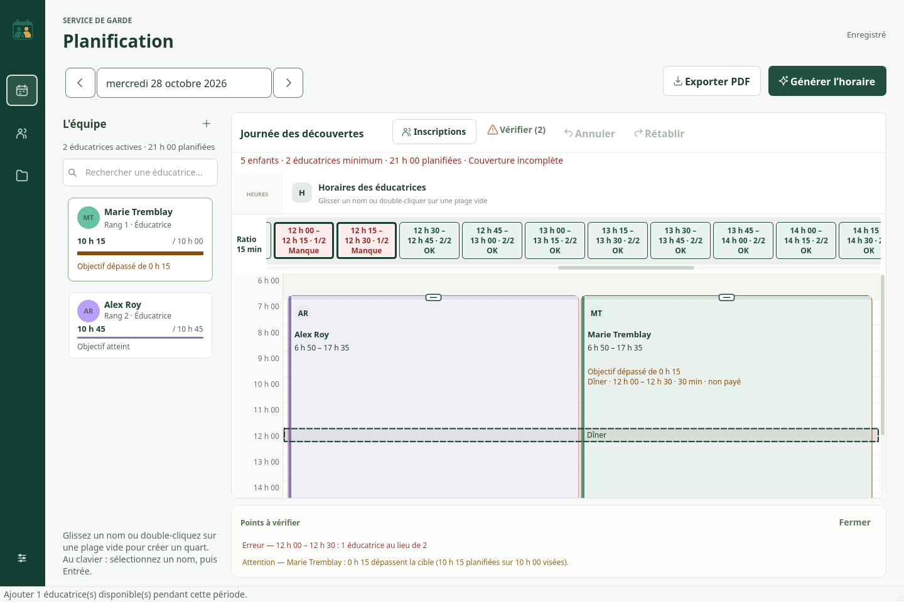

# Corrections de l’interface quotidienne

Les seize demandes correspondent aux commits numérotés 01 à 16. Le style Atelier est conservé. Les constructions et la publication portable portent la version 0.3.0. Un commit de livraison distinct enregistre le code exact vérifié par les deux plateformes.

| Étape | Résultat |
| --- | --- |
| 01 | Bande de couverture sous l’en-tête, valeurs présentes/requises, état textuel et couleur. |
| 02 | Vérifier (N), liste explicite, sélection au clic ou au clavier, défilement et surlignage. |
| 03 | Axe dès 6 h 00 et ouverture de la grille à son début. |
| 04 | Quart teinté selon l’éducatrice, bordure gauche de 4 px et texte d’au moins 12 px. |
| 05 | Pauses et dîner : heures, durée, rémunération, affichage dans le quart et calcul payé exact. |
| 06 | Boutons Annuler/Rétablir, raccourcis natifs, cinquante actions et abandon de la branche Rétablir après une nouvelle modification. |
| 07 | Inscriptions à la place d’Ajouter un quart ; glisser-déposer, double-clic vide ou Entrée depuis l’équipe au clavier. |
| 08 | Nom de journée éditable en place, Entrée/perte de focus pour enregistrer, Échap pour annuler ; nom présent dans le PDF. |
| 09 | Effectif saisi dans une fenêtre simple et besoin recalculé immédiatement. |
| 10 | Résumé des enfants, du minimum, des heures rémunérées et de l’état de couverture. |
| 11 | Une seule zone de planification, sans groupes dans l’interface ni préférences de groupes ; champ de date sans calendrier mensuel. |
| 12 | Objectif non défini vide, prochain rang libre et refus des doublons, sélecteurs d’heure natifs. |
| 13 | Format d’heure commun : 6 h 50, y compris les PDF. |
| 14 | Objectif dépassé en orange et maximum obligatoire dépassé en rouge, avec un libellé explicite. |
| 15 | Un indicateur de sauvegarde en haut à droite ; aucun statut permanent dans le bas de la fenêtre. |
| 16 | Poignées visibles à chaque extrémité ; navigation, déplacement et redimensionnement au clavier. |

## Règles retenues

- L’effectif constitue un seul bassin pour la journée. Pendant l’accueil : `max(2, plafond(enfants / ratio))`. Le ratio initial est 1/20 et reste modifiable dans les règles. Avec zéro inscription explicitement appliquée, la journée est fermée.
- Les dix minutes de préparation et les cinq minutes de fermeture exigent deux personnes au travail. Pendant l’accueil, les buffers et toutes les pauses sont exclus de la couverture ; seules les pauses non payées sont déduites des heures rémunérées.
- Les tranches suivent les quarts d’heure de l’horloge. Les bornes 6 h 50 et 17 h 35 créent deux tranches partielles. Le compteur affiche le cas le moins favorable de chaque tranche, sans moyenne ni arrondi des quarts. Les alertes conservent leurs limites exactes à la minute.
- Les anciens groupes restent dans les snapshots historiques. Leur analyse quotidienne utilise une copie réunie en un service ; modifier les inscriptions regroupe les affectations sans changer leurs heures. Si des ratios historiques diffèrent, le plus restrictif est conservé jusqu’à modification explicite des règles.
- Les heures garanties sont conservées parce que CP-SAT les applique comme minimum obligatoire. Cette utilisation est expliquée dans le formulaire.
- Les rangs de 1 à 11 sont uniques parmi les profils de la journée, y compris les profils inactifs. Ils peuvent rester non consécutifs ; aucun rang historique n’est corrigé silencieusement.
- Une alerte globale sans intervalle propre sélectionne la journée entière. Une alerte attachée à un quart sélectionne sa plage. Les erreurs de sous-effectif utilisent leur intervalle exact.

## Clavier

Dans l’équipe, Entrée crée le quart du profil sélectionné. Dans la grille, gauche/droite change de quart, haut/bas le déplace, Maj + haut/bas ajuste sa fin et Alt + haut/bas ajuste son début. Entrée ouvre le formulaire précis. Annuler et Rétablir utilisent les raccourcis de la plateforme : Cmd+Z/Cmd+Maj+Z sur Mac, Ctrl+Z/Ctrl+Maj+Z sur Windows. Les valeurs restent des minutes entières.

## Vérification

Les tests ajoutés couvrent les tranches et leurs bornes partielles, une pause d’une minute, les pauses payées/non payées, le dîner et sa sérialisation, les effectifs variables sans faux déficit, les alertes et leur sélection, l’historique de cinquante actions, les raccourcis, les sélecteurs et les champs vides, les rangs, le nom de journée et le PDF, ainsi que les poignées.

Le poste Linux dispose de ReportLab et d’un adaptateur temporaire Qt5 pour inspecter le code réel ; cet adaptateur n’est pas livré. Les suites complètes avec PySide6 et OR-Tools et les contrôles des exécutables portables sont exécutés sur les runners Windows et Mac de GitHub Actions. Les résultats de ces exécutions sont communiqués avec la livraison du code.

## Limites et éléments hors livraison

Cette révision n’ajoute pas de mise à jour automatique. Les ZIP publics se remplacent en conservant le dossier donnees, après sauvegarde. Le modèle PDF existant est conservé ; les pauses y restent vides, conformément à la demande précédente. Les contrôles d’accessibilité portent sur les widgets, les contrastes, les tailles et les événements clavier ; aucune certification avec un lecteur d’écran matériel n’est revendiquée.

Les captures sont des rendus du code réel avec des données fictives. Les valeurs de couverture se rapportent au personnel planifié, tandis que les incompatibilités de disponibilité restent signalées séparément par la validation.

## Fichiers modifiés

- `.github/release-request.json`
- `.github/workflows/publish-portable.yml`
- `README.md`
- `docs/CORRECTIONS_INTERFACE.md`
- `docs/ETAT_VERIFICATION.md`
- `docs/GUIDE.md`
- `docs/ajouter-educateur.png`
- `docs/apercu-interface.png`
- `docs/couverture-journee.png`
- `docs/exemple-horaire-pedagogique.pdf`
- `gardeplan/__init__.py`
- `gardeplan/alerts.py`
- `gardeplan/coverage.py`
- `gardeplan/hours.py`
- `gardeplan/installation_check.py`
- `gardeplan/models.py`
- `gardeplan/optimizer.py`
- `gardeplan/pedagogical_pdf.py`
- `gardeplan/planning.py`
- `gardeplan/ui/calendar.py`
- `gardeplan/ui/coverage_band.py`
- `gardeplan/ui/date_field.py`
- `gardeplan/ui/enrolment.py`
- `gardeplan/ui/forms.py`
- `gardeplan/ui/inline_name.py`
- `gardeplan/ui/main_window.py`
- `gardeplan/validation.py`
- `pyproject.toml`
- `tests/test_coverage.py`
- `tests/test_daily.py`
- `tests/test_daily_ui.py`
- `tests/test_day_selector.py`
- `tests/test_forms.py`
- `tests/test_main_window.py`
- `tests/test_pedagogical_pdf.py`
- `tests/test_schedule_ui.py`
- `tests/test_storage_pdf.py`
